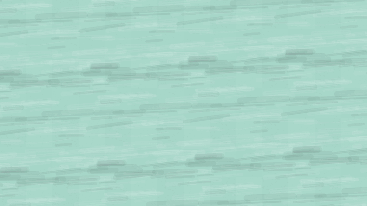

# handdrawn

把一段讲解稿做成**手绘逐笔画出**的讲解动画：铅笔跟着线头走，线条画完再上色，手写字从左往右写出来。每句话开口时就落笔，下一句开始前画完。

这是一个 [Claude Code](https://claude.com/claude-code) 的 skill：你把稿子交给 Claude，它按这里的规则写分镜、校验节奏、出 mp4。



## 安装

```bash
git clone https://github.com/shovyai/handdrawn.git ~/.claude/skills/handdrawn
```

装好以后，在 Claude Code 里直接说：

> 用 handdrawn 把这段稿子做成手绘讲解视频：……

Claude 会新建一个视频工程，先出一条 18 秒的演示片让你看画风，再换成你的内容。

## 需要什么

- Node.js 18 以上。ffmpeg 可选（只用来拼检查图的联系图）。
- 第一次出片时，Remotion 会自动下载一个无头 Chrome：下载约 170MB，解压后每个工程约占 570MB（在工程的 `node_modules` 里，做完可以删）。
- 目前只在 macOS 上测过，Windows 和 Linux 没有测试。

## 这一版能做什么

- 16:9、1920×1080 的 mp4，可以改成 2K。
- **不带配音。** 节奏按每秒约 4.2 个字估算，可以导出带字幕的版本，自己对着念配音。按录音自动对齐还没做。
- 自带一套手绘图库：人物、机器人、电脑、云、数据库、档案柜、箭头、对勾等，也可以用方框、线条自己拼。
- 出片前会自动检查：每句话有没有在下一句之前画完、开口时有没有落笔、字有没有压字或出框。

## 它是怎么工作的

1. 讲解稿写进 `data/script.json`：每个分句是一拍，也是一屏字幕。
2. 每一拍要画什么，写在 `src/scenes/` 的分镜里，按顺序一笔接一笔。
3. `npm run check` 按语速排出每一笔的时间。画不完、落笔太晚、画得太快，都会报错，并告诉你怎么改。
4. `npm run stills` 在每句画完的那一刻截一张检查图。
5. `npm run render` 出片。

细节在 [SKILL.md](SKILL.md)、[references/rules.md](references/rules.md)（画面规则）、[references/api.md](references/api.md)（分镜写法和零件）。

## 许可

- 代码：[MIT](LICENSE)。
- 字体：[霞鹜漫黑 LXGW Marker Gothic](https://github.com/lxgw/LxgwMarkerGothic)，SIL Open Font License 1.1，许可文件在 `template/public/fonts/`。可以随视频商用。
- 渲染用的 [Remotion](https://www.remotion.dev) 有自己的许可：个人、3 人以内的营利公司、非营利组织可以免费使用（包括商用）；规模更大的公司需要购买 [Remotion 公司许可](https://www.remotion.pro/license)。

---

**English.** A Claude Code skill that turns a narration script into a stroke-by-stroke hand-drawn explainer video (16:9, Remotion). Each clause of the script is one beat; the pencil starts drawing when the clause starts and finishes before the next one. This first version is silent (timing is estimated from reading speed). Install with `git clone https://github.com/shovyai/handdrawn.git ~/.claude/skills/handdrawn`. Code is MIT; the bundled font is OFL-1.1; Remotion has its own license (free for individuals and companies of up to 3 people). Docs are in Chinese. Tested on macOS only.
